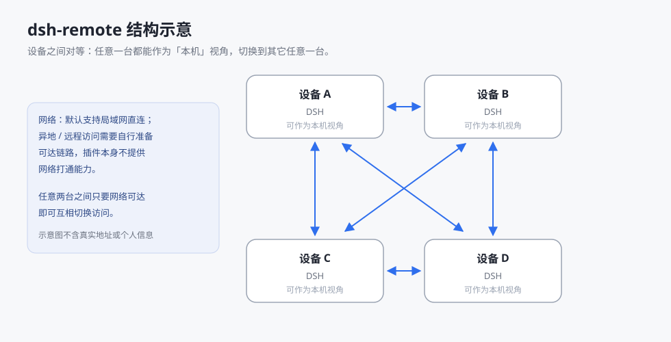

# dsh-remote

多设备 DSH 协作插件：在一个 DSH 界面里配置并切换到其它设备的 DSH。



## 功能

- **设备列表**：维护设备 A / B / C …，在侧栏一键切换到目标设备，一键回到本机。
- **会话与终端**：切换后照常使用会话、终端与工作区，页面始终由本机 DSH 渲染。
- **另存为**：把目标设备上的文件保存到本机。
- **分叉到**：把本机会话连同最近消息分叉到目标设备继续。
- **工作区跟随**：切换状态下新建工作区，显示目标设备的目录。

## 网络

- **默认支持局域网**：同一网络内直接填写设备的内网地址即可使用。
- **异地 / 远程**：需要用户自行准备可达的链路；插件不包含网络打通能力。
- 设备地址可填任意本机可达的 IP 或域名（物理网络、虚拟网络均可）。
- **手机 / 浏览器**：支持通过 Web 访问本机 DSH；所需链路同样由用户自行准备。

## 安装

```bash
dsh plugin --profile desktop add <插件包地址或本地路径>
```

安装后重启一次 DSH。

## 配置设备（以设备 A、设备 B 为例）

1. 在设备 B 上开启对外端口，并确认该端口可从设备 A 访问。
2. 在设备 B 上复制「本机地址/token」中的完整地址（形如 `http://设备B地址:端口/?token=…`）。
3. 在设备 A 上新增设备：名称自定（如 `设备B`）、填入地址、粘贴 token。
4. 在设备 A 的侧栏打开设备列表，切换到设备 B；点击「本机」返回。

多设备同理，每台设备添加其它设备各一条记录；需要双向切换时两端互相添加。

## 安全

- 访问凭据使用 DSH 自身的 token 与 cookie，插件不引入额外认证体系。
- token 仅保存在本机凭据存储中。
- 对外端口暴露到公网时，建议配合访问控制或限流措施。

> 发布与内容规范见 [RELEASE.md](RELEASE.md)。

## 诊断日志

- 设置 →「远程连接」→ 页面最下方的「诊断日志」：**下载日志** / **清空日志**；
- 日志文件：`$DSH_HOME/dsh-remote.log`（JSON Lines，2MB 轮转、保留 3 份）；
- 记录内容：插件启动、设备增删改与排序、代理请求的路径/状态码/耗时、垫片报到、认证失败等；
- **日志不包含 token、cookie、密码或密钥**（写入前统一脱敏）；
- 反馈问题时请附上日志文件，便于定位。

## 兼容性

| 插件版本 | DSH 版本 | 说明 |
|---|---|---|
| 0.15.x / 0.16.x | 0.2.1-rc.3 及以上 | 当前开发线（含诊断日志、更新提示、Alt+Home） |
| 0.13.x – 0.14.x | 0.2.1-rc.2 / rc.3 | 设备切换与设备管理修复 |
| 0.12.x 及更早 | 0.2.0.x | 设备面板与跨机状态点 |

> 升级 DSH 后建议同步升级插件；插件版本号显示在「设置 → 远程连接 → 体检」。


- 需要 DSH 桌面端或 Web 端。
- 升级 DSH 后建议同步升级插件。

## 开发

- `lib/index.js`：宿主侧（设备代理、注入、路由）。
- `lib/client.js`：客户端侧（设备列表与切换界面）。
- `selftest.mjs`、`selftest-client.mjs`：自测。